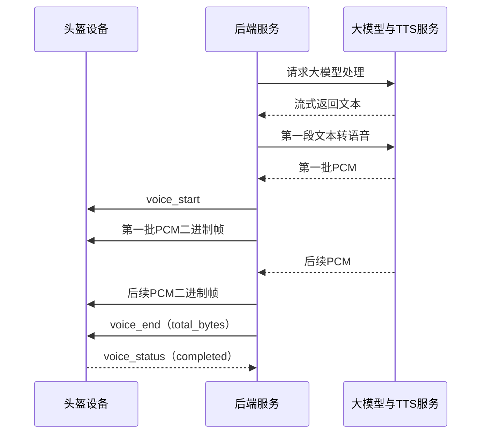
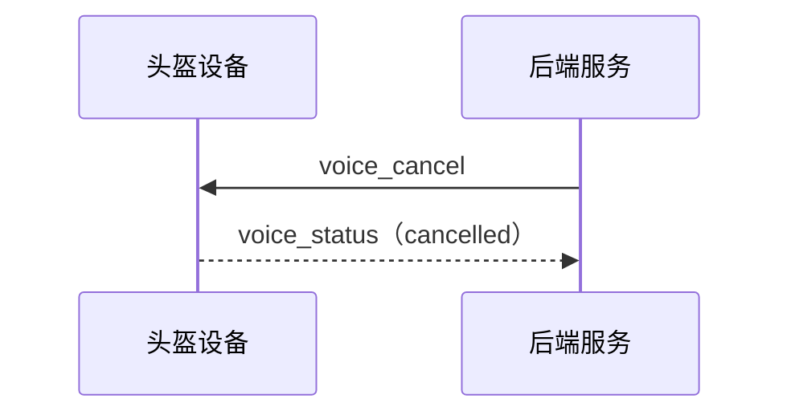

# 后端语音下发与设备播放协议

> 状态：待设备端与后端确认，尚未开发。

## 1. 协议范围

本协议定义后端向头盔设备下发语音并控制播放的交互流程，包括：

1. `voice_start`：开始一段语音；
2. PCM 二进制帧：下发语音数据；
3. `voice_end`：语音数据发送完毕；
4. `voice_cancel`：取消当前语音；
5. `voice_status`：设备返回完成、取消或失败状态。

TTS 生成过程、业务文本和大模型处理流程不属于本协议。

## 2. 通道与音频格式

| 通道 | 方向 | 数据类型 | 用途 |
| --- | --- | --- | --- |
| `/{sn}/cmd` | 双向 | UTF-8 JSON 文本帧 | 发送语音控制消息和返回播放状态 |
| `/{sn}/voice` | 后端 → 设备 | WebSocket 二进制帧 | 下发裸 PCM 数据 |

第一阶段音频格式固定为：

| 参数 | 值 |
| --- | --- |
| 编码 | `pcm_s16le` |
| 采样率 | 16000 Hz |
| 位深 | 16-bit |
| 声道 | 单声道 |
| 文件头 | 无 |

后端按语音内容顺序发送二进制帧，建议单个二进制帧不超过 3200 字节。

## 3. 语音任务标识

每段语音使用后端生成的唯一 `voice_id`：

```text
voice-1791802413001
```

同一语音任务的所有控制消息和状态回复必须使用相同的 `voice_id`。

同一设备第一阶段只允许存在一个语音任务。需要播放新语音时，后端应先取消尚未结束的旧语音。

## 4. 正常播放流程

### 4.1 后端发送 `voice_start`

```json
{
  "cmd": "voice_start",
  "voice_id": "voice-1791802413001",
  "format": "pcm_s16le",
  "sample_rate": 16000,
  "channels": 1
}
```

| 字段 | 类型 | 必填 | 说明 |
| --- | --- | --- | --- |
| `cmd` | string | 是 | 固定为 `voice_start` |
| `voice_id` | string | 是 | 本次语音任务唯一标识 |
| `format` | string | 是 | 第一阶段固定为 `pcm_s16le` |
| `sample_rate` | integer | 是 | 第一阶段固定为 `16000` |
| `channels` | integer | 是 | 第一阶段固定为 `1` |

后端发送 `voice_start` 时，必须已经生成至少一批可以下发的 PCM 数据。`voice_start` 发送后不等待设备回复，立即通过 `/{sn}/voice` 流式发送 PCM 二进制帧。

设备收到 `voice_start` 后建立当前语音任务，并对随后收到的 PCM 进行少量缓冲后开始播放。建议设备缓冲约 100～300 毫秒的音频，用于吸收 4G 或 Wi-Fi 网络抖动。

### 4.2 后端发送 PCM 数据

PCM 二进制帧只包含裸音频数据，不包含 JSON、文件头、Base64 或其他封装。

由于同一设备只允许一个语音任务，PCM 二进制帧不单独携带 `voice_id`，统一归属于当前 `voice_start` 建立的语音任务。

### 4.3 后端发送 `voice_end`

全部 PCM 数据发送完成后，后端发送：

```json
{
  "cmd": "voice_end",
  "voice_id": "voice-1791802413001",
  "total_bytes": 128000
}
```

| 字段 | 类型 | 必填 | 说明 |
| --- | --- | --- | --- |
| `cmd` | string | 是 | 固定为 `voice_end` |
| `voice_id` | string | 是 | 本次语音任务唯一标识 |
| `total_bytes` | integer | 是 | 本次语音发送的 PCM 总字节数 |

`total_bytes` 用于设备确认本次 PCM 数据已经完整接收。即使 `voice_end` 先于最后一个 PCM 二进制帧到达，设备也应等待累计接收字节数达到 `total_bytes`，再判断数据接收完成。

设备播放完全部缓冲数据后回复：

```json
{
  "cmd": "voice_status",
  "voice_id": "voice-1791802413001",
  "status": "completed"
}
```

## 5. 播放失败

设备无法建立语音任务、PCM 数据不完整或播放过程中发生错误时回复：

```json
{
  "cmd": "voice_status",
  "voice_id": "voice-1791802413001",
  "status": "failed",
  "error_code": "PLAYBACK_ERROR"
}
```

| `error_code` | 含义 |
| --- | --- |
| `PLAYER_BUSY` | 设备仍有其他语音任务 |
| `UNSUPPORTED_FORMAT` | 音频格式、采样率或声道不受支持 |
| `INCOMPLETE_AUDIO` | 实际接收的 PCM 字节数与 `total_bytes` 不一致 |
| `PLAYBACK_ERROR` | 设备播放失败 |
| `INTERNAL_ERROR` | 设备内部异常 |

`error_code` 只在 `status=failed` 时携带，不返回错误描述字段。

## 6. 取消播放

后端需要中断当前语音时发送：

```json
{
  "cmd": "voice_cancel",
  "voice_id": "voice-1791802413001"
}
```

设备收到后停止当前播放、清空尚未播放的缓冲数据，并回复：

```json
{
  "cmd": "voice_status",
  "voice_id": "voice-1791802413001",
  "status": "cancelled"
}
```

取消完成后，设备忽略该 `voice_id` 的后续数据。如果设备当前没有对应任务，也返回 `cancelled`，保证取消操作可以重复发送。

## 7. 超时与异常处理

- 后端发送 `voice_start` 后立即发送已经准备好的第一批 PCM，不等待设备回复；
- 后端发送 `voice_cancel` 后等待 5 秒，未收到 `cancelled` 时结束本次任务，不自动重复发送；
- 语音通道断开时，后端立即停止发送 PCM；
- 任一 WebSocket 通道断开时，设备停止并清理当前语音任务；
- 第一阶段语音任务失败后不自动重放。

## 8. 交互流程

正常播放：



取消播放：



## 9. 状态值汇总

| `status` | 方向 | 含义 |
| --- | --- | --- |
| `completed` | 设备 → 后端 | PCM 已完整接收并播放完成 |
| `cancelled` | 设备 → 后端 | 语音任务已取消并清理 |
| `failed` | 设备 → 后端 | 接收或播放过程中失败 |

## 10. 联调验收

1. 后端至少生成第一批 PCM 后才发送 `voice_start`；
2. 后端发送 `voice_start` 后不等待设备回复，立即流式发送 PCM；
3. 设备能够播放 16 kHz、16-bit、单声道裸 PCM；
4. 设备按照 `total_bytes` 确认 PCM 已完整接收；
5. 播放完成后设备返回 `completed`；
6. 收到 `voice_cancel` 后设备停止播放、清空缓冲并返回 `cancelled`；
7. PCM 数据不完整时返回 `failed + INCOMPLETE_AUDIO`；
8. 不支持的格式返回 `failed + UNSUPPORTED_FORMAT`；
9. WebSocket 断开时，双方终止当前语音任务。
