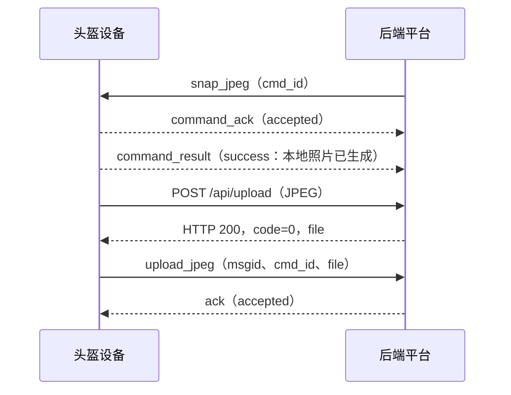

# 平台下发设备控制命令协议

> 状态：协议已确认；设备端与 Mac 本地演示后端已实现。四个命令、文件上传关联、拒绝分支和断线停止录音已完成真机联调；用户实体按键优先级仍待人工验收。正式后端仍需按此协议接入。

## 1. 范围与通道

平台通过已完成 `hello` / `hello_ack(accepted)` 的 `ws://{server}:{port}/{sn}/cmd` 通道下发命令。设备在同一通道返回接收确认和执行结果，均为 UTF-8 JSON 文本帧。

第一阶段只定义 `get_status`、`snap_jpeg`、`start_pcm`、`stop_pcm`。用户按键触发的拍照、录音流程不变。录像、重启、Wi-Fi 配置、定时状态上报不在本协议内。

平台命令由 `cmd_id` 关联；设备主动文件通知仍由 `msgid` 关联。二者不是同一个编号。

## 2. 平台下发命令

```json
{
  "cmd": "snap_jpeg",
  "cmd_id": "ctl-7f4c2a"
}
```

| 字段 | 类型 | 说明 |
| --- | --- | --- |
| `cmd` | string | 必填，以下四个命令之一 |
| `cmd_id` | string | 必填，平台生成的命令唯一标识；同一设备不重复使用 |

第一阶段四个命令均无需 `params`。

| `cmd` | 作用 | `command_result=success` 的含义 |
| --- | --- | --- |
| `get_status` | 查询设备运行状态 | 状态已返回 |
| `snap_jpeg` | 拍摄一张照片 | JPEG 已在设备本地生成，随后走已有上传流程 |
| `start_pcm` | 开始一段平台发起的录音 | 录音已开始 |
| `stop_pcm` | 结束平台发起的录音 | PCM 已在设备本地保存，随后走已有上传流程 |

`stop_pcm` 只允许停止平台通过 `start_pcm` 发起的录音，不得停止用户通过实体按键发起的录音。同一设备第一阶段最多同时进行一项拍照或录音操作。

## 3. 设备回复

设备收到有效命令后，先检查当前状态并返回 `command_ack`：

```json
{"cmd":"command_ack","cmd_id":"ctl-7f4c2a","status":"accepted"}
```

若当前无法执行，则回复 `rejected`，不再发送 `command_result`：

```json
{"cmd":"command_ack","cmd_id":"ctl-7f4c2a","status":"rejected","error_code":"DEVICE_BUSY"}
```

`accepted` 只表示设备接受执行，**不表示拍照、录音或文件上传已完成**。设备完成本地操作后再返回：

```json
{"cmd":"command_result","cmd_id":"ctl-7f4c2a","request_cmd":"snap_jpeg","status":"success"}
```

如果接受后发生本地执行错误，则返回：

```json
{"cmd":"command_result","cmd_id":"ctl-7f4c2a","request_cmd":"snap_jpeg","status":"failed","error_code":"EXECUTION_FAILED"}
```

`command_result` 必须携带原 `cmd_id` 和 `request_cmd`，且每个已接受的命令只返回一次最终结果。`error_code` 仅在 `rejected` 或 `failed` 时携带；第一阶段不定义自由文本 `message`。

| `error_code` | 使用阶段 | 含义 |
| --- | --- | --- |
| `INVALID_COMMAND` | `command_ack` | `cmd` 或 `cmd_id` 无效 |
| `UNSUPPORTED_COMMAND` | `command_ack` | 设备不支持该命令 |
| `DEVICE_BUSY` | `command_ack` | 用户操作优先，或摄像头/录音资源正被占用 |
| `NOT_RECORDING` | `command_ack` | 收到 `stop_pcm` 时，设备没有正在录制的音频；若正在录制用户按键音频则返回 `DEVICE_BUSY` |
| `EXECUTION_FAILED` | `command_result` | 接受命令后，本地拍照、录音或保存文件失败 |

无法识别 `cmd_id` 的消息不能可靠关联回复，设备可忽略并记录本地日志。`get_status` 应在拍照、录音或播放语音期间仍可查询。

## 4. `get_status` 返回数据

```json
{
  "cmd": "command_result",
  "cmd_id": "ctl-92b8e1",
  "request_cmd": "get_status",
  "status": "success",
  "data": {
    "recording": false,
    "recording_source": "none",
    "playing": false,
    "uptime_seconds": 3600,
    "app_version": "1.1.0"
  }
}
```

`recording_source` 取 `none`、`button`、`platform`，帮助平台判断能否发送 `stop_pcm`。`uptime_seconds` 是本次开机后的运行秒数。连接是否在线由 WebSocket 状态判断，本协议不重复返回 `network` 字段，也不增加 JSON 心跳。

## 5. 与已有文件上传协议的关系

平台触发的照片和录音仍使用已确认的 `POST /api/upload`、`upload_jpeg` / `upload_pcm` 和后端 `ack`。设备生成文件、HTTP 上传成功后，在 WebSocket 文件通知里额外带触发上传的 `cmd_id`：

```json
{
  "msgid": 127,
  "cmd_id": "ctl-7f4c2a",
  "cmd": "upload_jpeg",
  "file": "123456789012345-1791802413.jpeg"
}
```

- `snap_jpeg` 产生的上传通知使用该 `snap_jpeg` 的 `cmd_id`。
- `stop_pcm` 产生的上传通知使用该 `stop_pcm` 的 `cmd_id`；`start_pcm` 只表示录音开始。
- 用户实体按键产生的上传通知不带 `cmd_id`。
- `command_result=success` 只表示本地操作完成；HTTP 上传结果及后端是否受理文件，仍以已有上传协议的响应和 `ack` 为准。平台不能把 `command_result` 当作文件已受理。

## 6. 冲突与超时

| 收到命令时的情况 | 设备行为 |
| --- | --- |
| 用户正在按键录音，平台下发 `start_pcm`、`stop_pcm` 或 `snap_jpeg` | `command_ack: rejected + DEVICE_BUSY`；不打断用户 |
| 平台录音已开始，再下发 `start_pcm` 或 `snap_jpeg` | `command_ack: rejected + DEVICE_BUSY` |
| 没有任何录音时下发 `stop_pcm` | `command_ack: rejected + NOT_RECORDING` |
| 正在播放后端语音 | `get_status` 可用；涉及音频资源的 `start_pcm` 返回 `DEVICE_BUSY` |

后端等待 `command_ack` 最多 5 秒，接受后等待 `command_result` 最多 10 秒；超时不自动重发可能产生副作用的命令，而是先用 `get_status` 排查。设备断开命令 WebSocket 时，应停止并丢弃尚未完成的平台录音，避免无人控制的持续录音。

若平台录音期间用户按键，设备应优先处理用户操作，停止并丢弃平台录音；第一阶段平台可通过 `get_status` 发现录音已结束，不另定义中断事件。此条需要双方特别确认。

## 7. 简单交互示例



## 8. 联调验收

1. 四个命令分别返回对应的 `command_ack` 与 `command_result`；`get_status` 返回真实状态。
2. 用户正在录音时，平台命令被拒绝且用户录音不被中断；`stop_pcm` 不会停止用户录音。
3. 平台拍照或停止录音后，上传通知同时带独立的 `msgid` 和原命令 `cmd_id`，后端按既有上传协议回复 `ack`。
4. 不支持的命令、无平台录音时的 `stop_pcm`、本地执行失败均返回相应错误码。
5. 命令 WebSocket 断开后，平台发起的录音停止，重连后 `get_status` 显示未在录音。
