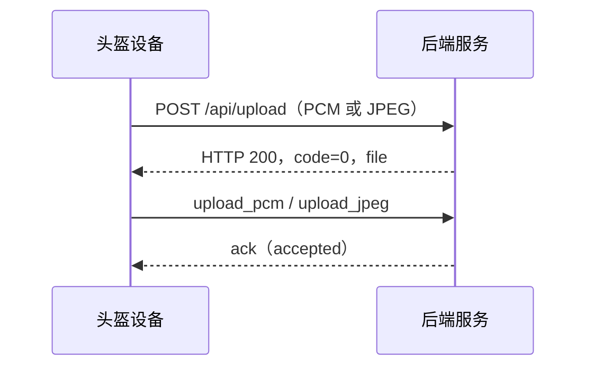

# 用户触发设备文件上传协议（拍照/录音）

> 状态：待设备端与后端确认，尚未开发。

## 1. 目标与范围

本协议只定义用户通过头盔实体按键录音或拍照后，设备如何上传文件，以及如何确认后端已经受理。

第一阶段只包含三个接口或消息：

1. `POST /api/upload`：设备上传 PCM 或 JPEG；
2. `upload_pcm` / `upload_jpeg`：设备通知后端处理文件；
3. `ack`：后端返回 `accepted` 或 `rejected`。

图片分析、语音识别、LangGraph、业务结果、TTS 和完整报告推送不属于本协议，由后续协议单独定义。

## 2. 交互流程图



异常情况不放入时序图：HTTP 上传失败、后端返回 `rejected`、5 秒未收到 `ack` 时，设备分别按照后文规则提示用户并结束本次交互。

## 3. 通道与数据类型

| 通道 | 方向 | 数据类型 | 用途 |
| --- | --- | --- | --- |
| `POST /api/upload` | 设备 → 后端 | `multipart/form-data` | 上传 PCM 或 JPEG |
| `/{sn}/cmd` | 双向 | WebSocket 文本帧，UTF-8 JSON | 文件通知和受理确认 |

实体按键触发的主动上报使用 `msgid`，不携带平台控制命令使用的 `cmd_id`。

## 4. 文件上传接口

### 4.1 设备端上传请求

```http
POST /api/upload
Content-Type: multipart/form-data
```

| 字段 | 类型 | 必填 | 说明 |
| --- | --- | --- | --- |
| `file` | binary | 是 | PCM 或 JPEG 文件 |

文件命名：

```text
{sn}-{时间戳}.pcm
{sn}-{时间戳}.jpeg
```

### 4.2 后端回复：上传成功

HTTP `200`：

```json
{
  "code": 0,
  "file": "123456789012345-1791802413.jpeg"
}
```

| 字段 | 类型 | 说明 |
| --- | --- | --- |
| `code` | integer | `0` 表示后端已成功接收并保存文件 |
| `file` | string | 后端实际保存的文件名，供后续 WebSocket 文件通知使用 |

设备确认 HTTP 状态为 `200` 且 `code=0` 后，使用后端返回的 `file` 发送 WebSocket 文件通知。上传成功阶段不播报语音。

`code=0` 用于表示业务处理成功：HTTP `200` 只表示请求已正常到达并获得响应，不能完全代替业务结果。

### 4.3 后端回复：上传失败

以下任一情况均视为上传失败：

- HTTP 无法连接或超时；
- HTTP 状态为 `4xx` 或 `5xx`；
- 返回 JSON 中 `code` 不为 `0`；
- 返回内容无法解析。

设备不发送 `upload_pcm` 或 `upload_jpeg`，播放本地提示“网络异常，请重新操作”，本次交互结束。

第一阶段不做长期自动重试。

## 5. 设备端通知后端处理已上传的图片/音频

文件上传成功后，设备通过命令 WebSocket 通知后端受理文件。

录音文件：

```json
{
  "msgid": 101,
  "cmd": "upload_pcm",
  "file": "123456789012345-1791802384.pcm"
}
```

图片文件：

```json
{
  "msgid": 102,
  "cmd": "upload_jpeg",
  "file": "123456789012345-1791802413.jpeg"
}
```

| 字段 | 类型 | 必填 | 说明 |
| --- | --- | --- | --- |
| `msgid` | integer | 是 | 设备生成的本次请求编号 |
| `cmd` | string | 是 | `upload_pcm` 或 `upload_jpeg` |
| `file` | string | 是 | HTTP 上传成功返回的文件名 |

## 6. 后端服务返回受理结果：接受/拒绝

后端收到文件通知后，应立即检查文件是否存在，以及任务是否可以进入后续处理流程。`ack` 不能等待后续业务处理完成后才发送。

接受：

```json
{
  "cmd": "ack",
  "msgid": 102,
  "status": "accepted"
}
```

设备播放本地提示“已收到，正在处理”，本协议流程结束。后续业务处理和返回结果由其他协议定义。

拒绝：

```json
{
  "cmd": "ack",
  "msgid": 102,
  "status": "rejected",
  "error_code": "FILE_NOT_FOUND"
}
```

`error_code` 只在 `status=rejected` 时携带，第一阶段定义如下：

| `error_code` | 含义 | 设备端行为 |
| --- | --- | --- |
| `FILE_NOT_FOUND` | 后端找不到已上传文件 | 提示重新拍照或录音 |
| `INVALID_FILE` | 文件损坏、为空或无法读取 | 提示重新拍照或录音 |
| `SERVICE_BUSY` | 服务暂时无法受理 | 提示稍后重新操作 |
| `INTERNAL_ERROR` | 后端内部异常 | 提示稍后重新操作 |

设备端根据 `error_code` 映射本地语音，不需要后端返回错误描述。对于未知或缺失的 `error_code`，设备播放“处理失败，请重新操作”。

## 7. 确认超时

设备发送文件通知后等待 5 秒：

```text
5秒内收到 ack：按 accepted/rejected 处理
5秒没有收到 ack：播放“服务无响应，请重新操作”，结束本次交互
```

第一阶段不自动补发，不维护持久化待确认队列。

## 8. 设备本地提示

| 场景 | 提示语音 |
| --- | --- |
| HTTP 上传失败 | 网络异常，请重新操作。 |
| 后端 `accepted` | 已收到，正在处理。 |
| 图片任务 `FILE_NOT_FOUND` / `INVALID_FILE` | 处理失败，请重新拍照。 |
| 录音任务 `FILE_NOT_FOUND` / `INVALID_FILE` | 处理失败，请重新录音。 |
| `SERVICE_BUSY` / `INTERNAL_ERROR` | 服务暂时不可用，请稍后重试。 |
| 未知或缺失的 `error_code` | 处理失败，请重新操作。 |
| 5 秒未收到 `ack` | 服务无响应，请重新操作。 |

以上提示使用设备本地 PCM 或 MP3，不依赖后端 TTS。

## 9. 本接口未包括

- ASR、VLM 和 LangGraph 处理流程；
- 图片质量和检查对象判断；
- 隐患分析与整改建议；
- 业务结果和 TTS 返回协议；
- `processing_result`；
- 自动重发和离线任务队列；
- 平台下发命令及 `cmd_id`；
- 多任务并发。

## 10. 联调验收

1. PCM 上传成功后，设备发送 `upload_pcm`，后端返回 `accepted`；
2. JPEG 上传成功后，设备发送 `upload_jpeg`，后端返回 `accepted`；
3. HTTP 上传失败时，设备不发送文件通知并提示网络异常；
4. 后端返回 `rejected` 时，设备根据文件类型和 `error_code` 播放本地提示；
5. 5 秒未收到 `ack` 时，设备提示服务无响应并结束本轮交互。
