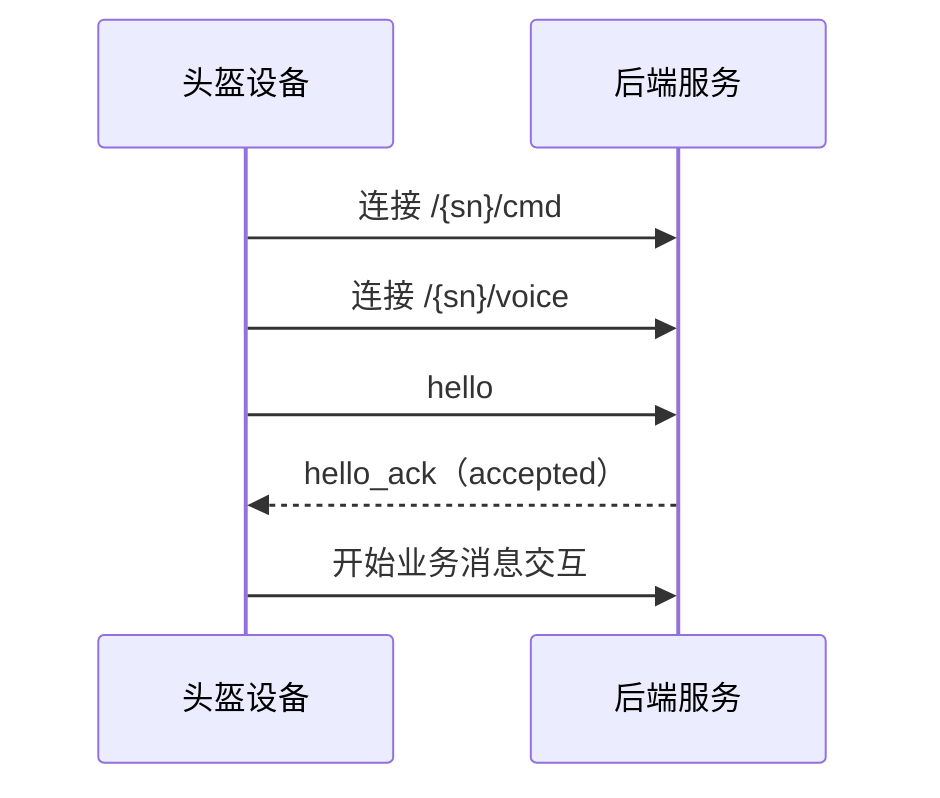

# 设备接入与 WebSocket 连接协议

> 状态：待设备端与后端确认，尚未开发。

## 1. 协议范围

本协议定义头盔设备与后端建立 WebSocket 连接后的设备识别与接入确认，包括：

- WebSocket 通道；
- 设备唯一标识 `sn`；
- `hello` 接入请求；
- `hello_ack` 接入结果；
- 握手超时与重新连接约定。

文件上传、业务处理、语音播放和平台控制命令由其他协议定义。

## 2. WebSocket 通道

| 通道 | URL | 数据类型 | 用途 |
| --- | --- | --- | --- |
| 命令通道 | `ws://{server}:{port}/{sn}/cmd` | UTF-8 JSON 文本帧 | 接入握手、设备事件和控制消息 |
| 语音通道 | `ws://{server}:{port}/{sn}/voice` | WebSocket 二进制帧 | 后端向设备发送语音数据 |

`sn` 使用头盔设备的 IMEI 号。命令通道和语音通道必须使用相同的 `sn`。

## 3. 设备接入请求 `hello`

命令通道每次建立成功后，设备立即发送一次 `hello`：

```json
{
  "cmd": "hello",
  "sn": "123456789012345",
  "protocol_version": "1.0",
  "app_version": "1.0.0"
}
```

| 字段 | 类型 | 必填 | 说明 |
| --- | --- | --- | --- |
| `cmd` | string | 是 | 固定为 `hello` |
| `sn` | string | 是 | 设备 IMEI，应与 WebSocket URL 中的 `sn` 一致 |
| `protocol_version` | string | 是 | 设备与后端的协议版本 |
| `app_version` | string | 是 | 设备端应用版本 |

`hello` 是连接级消息，不携带业务事件使用的 `msgid`，也不携带平台控制命令使用的 `cmd_id`。

## 4. 后端接入结果 `hello_ack`

后端收到 `hello` 后，应校验设备标识和协议版本，并立即返回 `hello_ack`。

### 4.1 接受

```json
{
  "cmd": "hello_ack",
  "status": "accepted"
}
```

设备收到 `accepted` 后，才发送文件上传通知等业务消息。

### 4.2 拒绝

```json
{
  "cmd": "hello_ack",
  "status": "rejected",
  "error_code": "SN_MISMATCH"
}
```

| `error_code` | 含义 |
| --- | --- |
| `DEVICE_NOT_ALLOWED` | 设备未登记或不允许接入 |
| `SN_MISMATCH` | URL 中的 `sn` 与 `hello.sn` 不一致 |
| `UNSUPPORTED_PROTOCOL` | 后端不支持设备的协议版本 |
| `INTERNAL_ERROR` | 后端内部异常 |

`error_code` 只在 `status=rejected` 时携带，不返回错误描述字段。

## 5. 超时、保活与重连约定

- 后端应在收到 `hello` 后 5 秒内返回 `hello_ack`；
- 5 秒未收到 `hello_ack`，设备关闭当前连接；
- WebSocket 连接失败或断开后，设备固定等待 10 秒重新连接；
- 每次重新建立命令通道后，设备重新发送 `hello`；
- 保活使用标准 WebSocket Ping/Pong 控制帧，不定义 JSON `heartbeat` 消息；
- 后端应正确响应标准 WebSocket Ping 控制帧。

## 6. 交互流程



## 7. 联调验收

1. 命令通道建立后，后端能够收到并解析 `hello`；
2. URL `sn` 与 `hello.sn` 一致且协议版本受支持时，后端返回 `accepted`；
3. URL `sn` 与 `hello.sn` 不一致时，后端返回 `rejected + SN_MISMATCH`；
4. 协议版本不受支持时，后端返回 `rejected + UNSUPPORTED_PROTOCOL`；
5. 设备断线重连后会重新发送 `hello`，后端可重复完成接入确认；
6. 后端支持标准 WebSocket Ping/Pong 保活。
